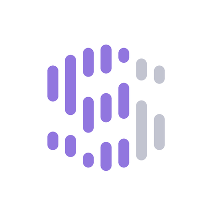
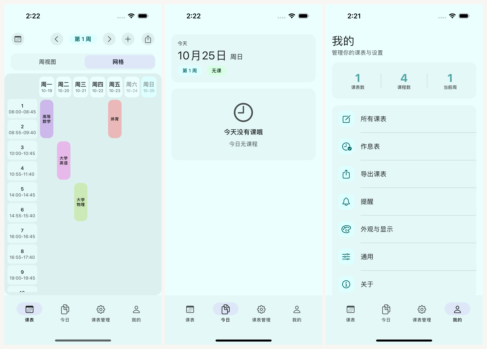

<p align="center">
  
</p>

<h1 align="center">Sleepy · 轻课表 iOS</h1>

<p align="center">
  A clean, Material You iOS schedule/timetable app built with Swift + SwiftUI + GRDB + WidgetKit.<br>
  Material You 设计的纯净 iOS 课程表 App — 多视图 · 教务直连 · 桌面小组件 · HSV 自定义配色
</p>

<p align="center">
  <a href="https://github.com/lingion/sleepy-ios/releases"></a>
  
  
  
  
  
  
  
</p>

<p align="center">
  <a href="https://github.com/lingion/sleepy-ios/releases">下载 IPA</a> · <a href="https://sleepy.is-my.app">官网</a> · <a href="https://sleepy.is-my.app/preview">在线体验</a> · <a href="https://github.com/lingion/sleepy">Android 原版</a> · <a href="#社区">💬 社区</a> · <a href="https://github.com/lingion/sleepy/blob/main/sponsor.md">赞助</a>
</p>

---

> **Keywords (SEO):** iOS schedule app, 课程表, 课表, timetable, university schedule, SwiftUI, WidgetKit, iOS widget, home screen widget, 教务导入, 教务直连, 正方教务, 超星教务, 强智教务, wisedu, URP, 开源课表, 开源课程表, 离线课表, 无广告课表, 隐私课表, 大学课表, 高校课表, ICS 课表, WakeUp 替代, 课程格子 替代, 超级课程表 替代, class timetable, school timetable, university timetable, course schedule

---

## 截图一览

<p align="center">
  
</p>

<p align="center">
  iOS 16.0+ · 包名 <code>com.lingion.sleepy</code> · 版本以 <a href="https://github.com/lingion/sleepy-ios/releases">Releases</a> 为准
</p>

---

## 概要

| 项 | 值 |
|---|---|
| 包名 | `com.lingion.sleepy` |
| 最低版本 | `16.0` |
| 架构 | arm64 |
| 语言 | zh-CN · zh-TW · en · ja · es |

**课表 App 又要广告又要登录云端？** **想看下一节课却要点开 App？**

Sleepy iOS 版是 [Android 原版](https://github.com/lingion/sleepy)的 SwiftUI 移植，主旨：**轻、快、准**。课表数据保存在设备本地（GRDB/SQLite），日常查看和编辑可离线使用，未集成任何第三方分析 SDK；教务导入会访问学校站点。另支持 WakeUp JSON、WakeUp 分享文本、ICS、CSV 与原生文本导入，导出的 ICS 可导入 Apple Calendar 等日历应用。

---

## 三视图

课表页提供周视图和网格视图，顶部 SegmentedSwitcher 切换；今日课程在底部「今日」标签页。

| 视图 | 说明 |
|---|---|
| **周视图**（按天归组的课程列表） | 横向时间轴，展示整周课程 |
| **网格视图**（时间网格 · 课程色块） | 经典课程表布局 |
| **今日**（底部 Tab） | 只看今天有哪些课 |

特性：

- 左/右滑周切换器，实时算周次
- 课程按「起止周 + 单双周 + 起止节」自动过滤当前周
- 点击课程卡片弹出详情底部弹窗

---

## 多课表管理

可同时管理多张独立课表，每张表拥有自己的节次时间表、开学日期和最大周数。作息表（节次时间表）独立管理，可被多张课表共用。

新建/编辑课表必填项：名称、开始日期、最大周数、节次时间表。

「我的」顶部统计卡可进入全部课表或课程清单；课程清单将同一课程的地点和上课安排归组展示。

---

## 节次配置

「我的 → 节次时间表」管理多套作息表：手动模式逐节设置起止时间，节次头部信息可自定义。

---

## 教务系统导入

入口在「我的 → 导入课表」，支持 40+ 学校教务协议解析器，覆盖主流教务系统族与单校定制协议：

| 协议族 | 解析器 |
|---|---|
| 正方 | Classic EAMS、新版正方、Eams5 变体 |
| 超星 | `chaoxing` 系接口 |
| 强智 | `wisedu`（`jwgl` 登录 + 课表接口） |
| URP | `urp` / 新版 URP |
| 青果/乘方 | CF（`cf`）教务，HTML 内嵌课表数据解析 |
| 单校定制 | 北京大学、北京航空航天大学、中国科学院大学、北京交通大学、武汉理工大学、东北大学、湖南科技大学、重庆大学、昆明理工大学、燕山大学、北京师范大学珠海分校、西南交通大学… |

学校目录区分「已支持」和「待验证可尝试」两种状态，收录不等于保证导入成功；支持自定义教务站点 URL 尝试未收录学校。导入凭据只在设备上使用，不落第三方。

---

## 手动添加课程

入口在底栏「课表管理」→「添加课程」。

字段：课名 · 教师 · 教室 · 备注 · 星期 · 起止节 · 起止周 · 单双周类型 · 课程色。

---

## 冲突课程和撤回

同一时间有多门课程时，网格视图以叠层方式呈现（`ConflictCard`），不会静默丢失；冲突详情可在底部弹层查看。

手动添加或编辑课程遇到冲突时，提示会列出重叠的课程，确认后才保存。

课表数据修改支持撤回/重做（`UndoManager`）。

---

## 课程通知 & 提醒

入口在「我的」→「提醒」。总开关默认关闭，开启时请求通知权限。

| 子功能 | 触发时机 | 内容（动态生成） |
|---|---|---|
| **每日摘要** | 每天指定时间 | 今日节数、第一节课的课名、时间与教室 |
| **明日摘要** | 单独设置每天提醒时间 | 提前查看明天的课程安排 |
| **每节课前提醒** | 每节课前 N 分钟 | 下节课的课名、时间与教室 |
| **上课自动勿扰** | 上课期间 | 授予专注模式权限后，上课开启勿扰、下课恢复 |

- 课前分钟数自由输入（1–999）
- 提醒内容动态查询当天课表，页面提供当前课表的动态内容预览；无课时推送「今天没有课程」
- 每日/明日摘要的提醒时间可分别配置

---

## 导出课表与备份

入口在「我的」→「导出课表」。四种格式：

| 格式 | 用途 |
|---|---|
| WakeUp JSON | 供 WakeUp / Android 版 Sleepy 导入 |
| 分享文本 | 直接分享课表内容 |
| ICS | 导入 Apple Calendar 等日历应用 |
| Sleepy 原生 | 跨设备迁移 / 备份 |

「我的 → 通用设置」提供全量备份与换机迁移包（`MigrationBackup`），课表、作息、设置打包导出。

---

## 桌面 Widget（5 类）

五类 Widget 通过 WidgetKit 实现，App Group 数据共享。

| Widget | 支持尺寸 | 用途 |
|---|---|---|
| **Today** | 小、中、大 | 今日课程列表 |
| **TwoDay** | 中、大 | 今天 + 明天 |
| **WeekList** | 中、大 | 7 日课程统计 + 名称 |
| **WeekGrid** | 中、大 | 完整时间网格 + 课程块 |
| **WeekView** | 中、大 | 周视图 |

实现要点：

- 纯 WidgetKit 实现
- App Group：`group.com.lingion.sleepy`
- 配色与 app 主题实时同步（深色模式）
- 课程色按黄金角 (137.508°) HSL 分布

---

## 课表管理与通用设置

「我的 → 所有课表」集中管理课表；「通用设置」收敛全局行为与外观以外的杂项开关。

### 节假日与调休

「我的 → 节假日设置」按教学周管理放假日段：每个假日段一张卡片，可逐日映射补班日；失效映射单独提示，已删除假日可恢复，支持添加自定义日期。

### 深色模式与自定义主题

浅色 / 深色 / 跟随系统三种模式（「我的」→「外观」），默认跟随系统。

- **自定义主题编辑器**（`CustomThemeEditorScreen`）：滑杆调节色相/彩度，实时预览主题色与表面色，生成整套课程色板
- **课表显示设置**（`ScheduleDisplayScreen`）：调整课表呈现方式

---

## 关于

入口在「我的」→「关于」，集中展示版本、作者与开源信息。

| 区块 | 内容 |
|---|---|
| **版本信息** | 版本号 + 构建号，可查看更新说明 |
| **作者** | Lingion，点击跳 GitHub 主页 |
| **开源地址** | github.com/lingion/sleepy-ios，点击可跳转 |
| **开源声明** | GPL-3.0 协议说明与依赖许可列表 |

---

## 技术栈

```
language        = Swift 5.9
ui              = SwiftUI
storage         = GRDB 6.29.3 (SQLite)
widgets         = WidgetKit
navigation      = SwiftUI NavigationStack
prefs           = AppPrefs (UserDefaults)
serialization   = Codable
build           = XcodeGen 14.3.1
xcode           = 14.3.1
```

---

## 项目结构

```
Sleepy/
├── SleepyApp.swift              # App 入口（Tab 壳 + overlay 导航 + 深链）
├── data/
│   ├── entity/ dao/ repository/ # GRDB 实体、数据访问、仓储
│   ├── parser/                  # ScheduleParser（多格式导入）/ ScheduleExporter（导出）
│   ├── jw/                      # 教务协议解析器 40+ · 学校目录 · 城市/域名定位
│   ├── migration/               # 全量备份与换机迁移
│   ├── calendar/ diff/ undo/    # 系统日历 · 课表差异 · 撤回
├── theme/                       # Theme + ThemePresets + 自定义主题
├── ui/
│   ├── component/               # CourseTableView / ConflictCard / PillNavigationBar / SegmentedSwitcher
│   └── screen/
│       ├── schedule/            # 周视图 + 网格视图 + 今日
│       ├── imports/             # 课表导入（含教务抓取）
│       ├── edit/                # 课程编辑 / 添加课程
│       ├── manage/              # 课表管理
│       ├── mine/                # 我的 / 外观 / 主题 / 提醒 / 导出 / 节假日 / 关于
│       └── widget/              # Widget 编辑与管理
├── widget/                      # WidgetKit provider 与视图
├── resources/                   # 多语言 Localizable.strings + schools.json
├── util/                        # AppPrefs / DateUtils
├── SleepyWidget/                # Widget Extension
├── SleepyTests/                 # 单元测试
├── SleepyUITests/               # UI 测试
├── scripts/                     # 构建/测试脚本
├── project.yml                  # XcodeGen 配置
└── README.md
```

---

## 构建 & 安装

### 前置

安装 XcodeGen，并确保 Xcode 14.3 或更高版本：

```bash
brew install xcodegen
```

### 编译

```bash
git clone https://github.com/lingion/sleepy-ios.git
cd sleepy-ios

# 生成 Xcode 项目
xcodegen generate

# Debug 构建
xcodebuild -project Sleepy.xcodeproj \
  -scheme Sleepy \
  -destination 'platform=iOS Simulator,name=iPhone 14' \
  build
```

> **没有 Mac 也能构建**：仓库配有 `iOS Build` workflow，用 GitHub Actions 免费的 macOS runner 云端出无签名 IPA（供 AltStore 重签）并可跑模拟器测试：
>
> ```bash
> gh workflow run "iOS Build" -f ref=master -f config=Release
> ```
>
> 详见 [docs/ci-automation.md](docs/ci-automation.md)。

### 测试

```bash
# 单元测试
xcodebuild -project Sleepy.xcodeproj \
  -scheme Sleepy \
  -destination 'platform=iOS Simulator,name=iPhone 14' \
  test

# UI 测试
xcodebuild -project Sleepy.xcodeproj \
  -scheme Sleepy \
  -destination 'platform=iOS Simulator,name=iPhone 14' \
  -only-testing:SleepyUITests \
  test
```

### 安装

下载 Release 中的 IPA 文件，使用 AltStore 或 SideStore 签名安装。

---

## 社区

Bug 反馈和新学校适配请提交到 [Issues](https://github.com/lingion/sleepy-ios/issues)；想聊天、提建议、第一时间了解新版本，可以加入 QQ 交流群（与 Android 版同群）：

**QQ 群：`1063407652`**（在 QQ 中搜索群号 → 申请加入）

不方便加群也没关系，[Discussions](https://github.com/lingion/sleepy-ios/discussions) 里同样会认真回复。

---

## 文档

- **[官网](https://sleepy.is-my.app)** — 项目主页：功能介绍、学校名录、下载中心、常见问答
- **[在线体验](https://sleepy.is-my.app/preview)** — Web 版课表，浏览器打开即用，无需安装；支持多格式导入（WakeUp 分享文本 / ICS / CSV / Excel），数据仅存本地
- **[Android 原版](https://github.com/lingion/sleepy)** — Sleepy 起源仓库：Kotlin + Jetpack Compose，附 [Wiki 手册](https://github.com/lingion/sleepy/wiki) 与[使用指南](https://blog.qdp.qzz.io/docs/sleepy/overview)
- **[CI 自动化](docs/ci-automation.md)** — 云端构建无签名 IPA 与模拟器测试的流程说明

---

## 许可证

[GPL-3.0](LICENSE)

Sleepy 使用 GPL-3.0 发布。教务导入适配、协议研究和课表格式工作参考了多个开源项目，项目依赖与许可列表见应用内「我的 → 关于 → 开源声明」。

---

<p align="center">
  <sub>构建无壳，自由自在。</sub>
</p>
